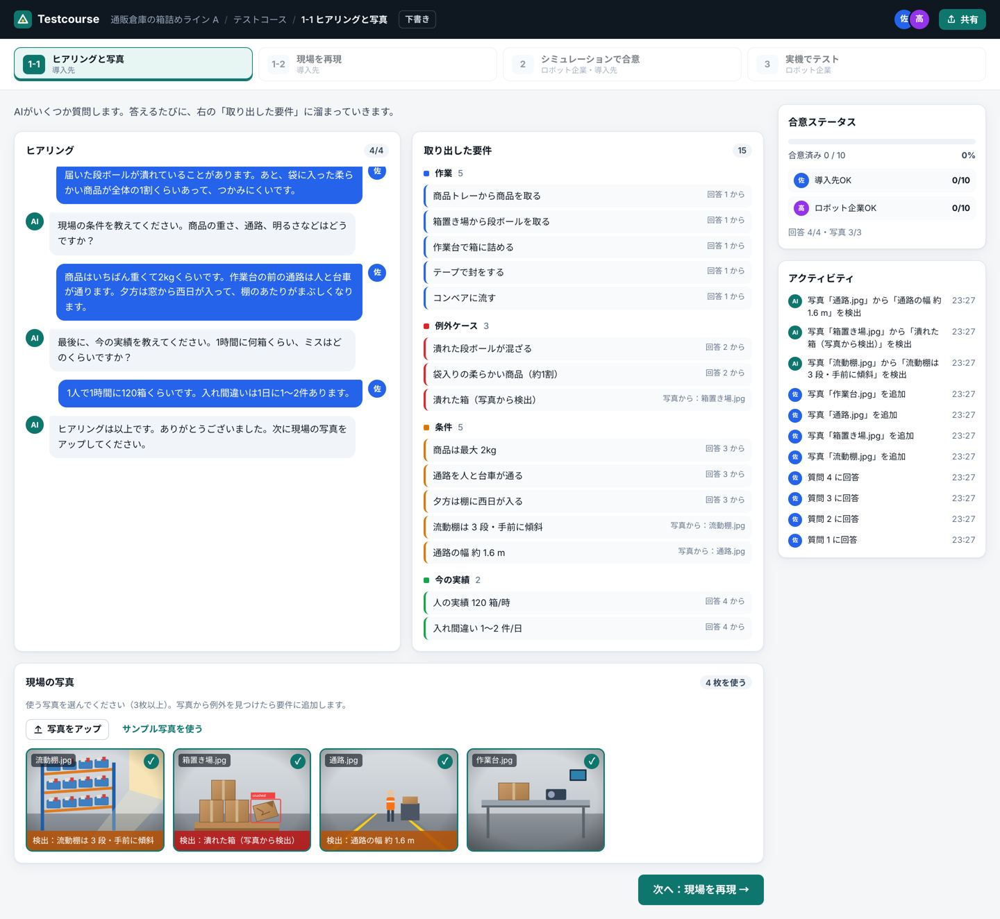
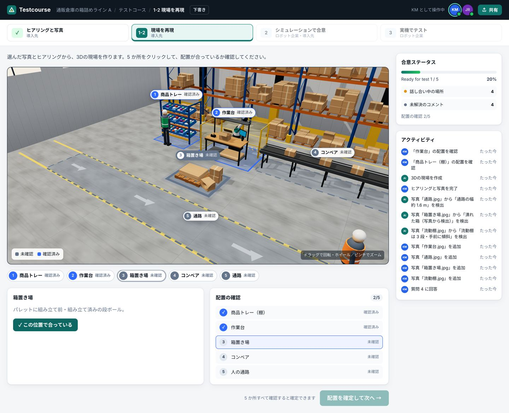
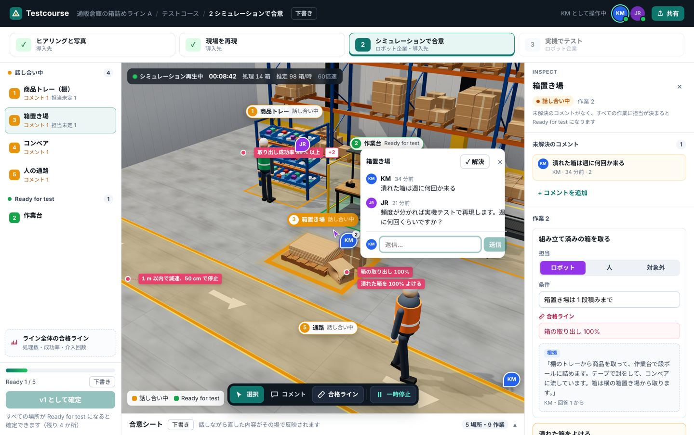
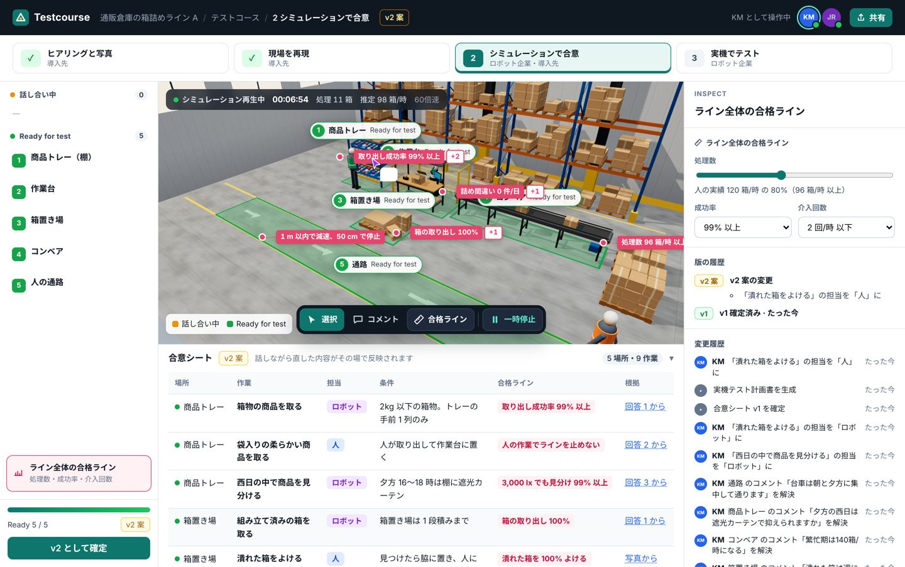
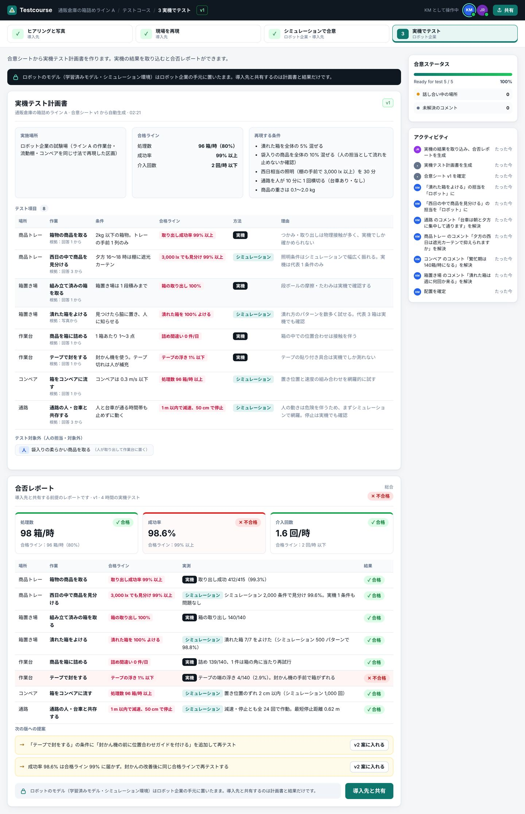

# Testcourse（Web プロトタイプ）

ロボットが来る前に、導入先（倉庫・工場の現場責任者）とロボット企業（Deployment Lead）が同じ 3D のテストコースを一緒に見て、
話しながら「何ならできる・何はできない・どこまでやるか」を決めていくツールのプロトタイプです。
ステップ 2 は Figma のデザインレビューのように、同じ画面の上で直していく作りにしています。

- サンプル現場：架空の「通販倉庫の箱詰めライン A」
- バックエンドなし。状態はすべてブラウザ内（React + zustand）で持ち、再読み込みで初期化されます
- React 19 + Vite + TypeScript + react-three-fiber（three.js）+ drei

## 画面の流れ

| ステップ | 担当 | 内容 |
| --- | --- | --- |
| 1-1 ヒアリングと写真 | 導入先 | AI の質問に答えると「取り出した要件」（作業・例外ケース・条件・今の実績）が溜まる。写真をアップ（またはサンプル写真）して使う写真を選ぶと、例外（潰れた箱など）を検出して要件に追加。回答 4 つ・写真 3 枚で次へ |
| 1-2 現場を再現 | 導入先 | 「3Dの現場を作る」で 3D シーンを生成（演出）。作業台・商品トレー・箱置き場・コンベア・人の通路の 5 か所を確認して確定 |
| 2 シミュレーションで合意 | 両者 | Figma 型の作業画面（下で詳しく）。話しながら直した内容がその場で合意シートに入り、すべての場所が Ready for test になったら「v1 として確定」。確定後の変更は v2 案として履歴に残る |
| 3 実機でテスト | ロボット企業 | 合意シートから実機テスト計画書を自動生成（実機かシミュレーションかと理由）。「実機の結果を取り込む」で合否レポートと次の版への提案。モデルはロボット企業の手元に置き、共有は結果のみ |

上部のステップ表示で行き来できます（前のステップが終わるまで次は押せません）。

| 1-1 | 1-2 |
| --- | --- |
|  |  |
| **2（話し合い中）** | **2（確定後・合意シート）** |
|  |  |
| **3** | |
|  | |

### ステップ 2 の画面

| 場所 | 内容 |
| --- | --- |
| 左パネル | 場所の一覧を「話し合い中」「Ready for test」の 2 グループで表示（件数・未解決コメント数・担当未定の数）。下に「ライン全体の合格ライン」と確定ボタン |
| 中央 | 3D の現場。シミュレーションの再生・一時停止（60 倍速の時計と処理数）、ライブカーソル、コメントピン、合格ラインのラベル |
| 右パネル（Inspect） | 選んだ場所の作業ごとに 担当・条件・合格ライン・根拠（ヒアリングでの発言と出典）をその場で編集。未解決コメントと変更履歴（誰が・何を・何分前） |
| 下のツールバー | 選択（V）／コメント（C）／合格ラインのラベル表示（L）／再生・一時停止（Space） |
| 合意シート | 中央の下から引き出す。場所・作業・担当・条件・合格ライン・根拠。編集した行は一瞬光る |

- **場所の状態**：未解決のコメントがなく、その場所の作業すべてに担当が決まっていれば **Ready for test**、そうでなければ **話し合い中**。3D の色も同じ（橙／緑）
- **コメント**：3D の場所にピン留め。ピンを押すとスレッドが開き、返信・解決ができる。コメントツールで 3D をクリックすると新しいピンを置ける（いちばん近い場所に紐づく）。スマホではスレッドを 3D の下に出す
- **合格ラインのラベル**：寸法ラベルのように場所の横に浮かぶ。押すと Inspect のその項目にフォーカス。選んでいない場所は 1 件＋残りの件数だけ表示
- **共同編集の見せ方**：同時編集のサーバーはなく演出です。上部のアバター（KM＝導入先、JR＝ロボット企業）を押すと操作する人が切り替わり、コメント・変更履歴の名前が変わります。相手のカーソルは 3D の場所を巡ってゆっくり動きます（カメラを回しても 3D の位置に付いてきます）

## ローカルで起動

Node.js 20.19 以上（22 推奨）が必要です。

```bash
cd testcourse
```

```bash
npm install
```

```bash
npm run dev
```

ブラウザで http://localhost:5173 を開きます。本番ビルドの確認は次のとおりです。

```bash
npm run build
```

```bash
npm run preview
```

## 静的サイトとして公開（Cloudflare Pages）

ビルド結果（`testcourse/dist`）は静的ファイルだけなので、そのまま配信できます。

### Git 連携で自動デプロイ

1. Cloudflare ダッシュボード → Workers & Pages → Create → Pages → Connect to Git でこのリポジトリを選ぶ
2. ビルド設定
   - Framework preset：`Vite`（または None）
   - Root directory：`testcourse`
   - Build command：`npm run build`
   - Build output directory：`dist`
   - 環境変数：`NODE_VERSION` = `22`
3. Save and Deploy。以後、push のたびにデプロイされます（ブランチごとにプレビュー URL も出ます）

### 手元からアップロード（Wrangler）

```bash
cd testcourse && npm run build
```

```bash
npx wrangler pages deploy dist --project-name testcourse
```

ルーティングは 1 ページだけなので、`_redirects` などの追加設定は不要です。

## フォルダ構成

```
testcourse/
├─ src/
│  ├─ i18n/ja.ts          … UI の文言（ここに集約。英語は en.ts を同じ形で足して index.ts で切り替え）
│  ├─ data/sample.ts      … サンプル現場のデータ（質問・回答例・作業・条件・合格ライン・場所・コメント・変更履歴・実機の結果）
│  ├─ data/photos.ts      … デモ用のサンプル写真（SVG で描いた絵）
│  ├─ data/renders.ts     … Unreal Engine などのレンダー画像・動画への差し替え口
│  ├─ store.ts            … 画面の状態（ステップ、要件、合意シート、版、アクティビティ）
│  ├─ components/Shell.tsx… アプリバー・ステップ表示・右側の合意ステータス／アクティビティ
│  ├─ steps/              … Step11 / Step12 / Step2 / Step3
│  └─ three/              … 3D（Scene：配置・照明・クリック判定、models：倉庫のモデル、textures：床などの質感、anchors：3D の位置に DOM を重ねる仕組み）
└─ public/renders/        … レンダー画像・動画の置き場
```

- 文言はすべて `src/i18n/ja.ts`。サンプルデータの文章は `src/data/sample.ts` にあり、現場を差し替えるときはこのファイルだけ書き換えます
- 「診断」という語は使っていません

## 3D について

- 棚（流動棚・パレットラック）、パレット、段ボール（潰れた箱を含む）、コンベア（ベルトと箱が流れる）、作業台、ロボットアーム（ピック動作）、安全柵、人（歩行）、台車を置いています
- 太陽光（西の窓からの西日）と影（PCF ソフトシャドウ）、半球光、天井照明、環境光の反射（drei の Lightformer で生成。外部の HDRI は使わない）、フォグ
- 床はコンクリートの質感（色ムラ・タイヤ痕・ラフネス）を Canvas で生成。通路の白線・矢印・立入禁止の斜線
- カメラ操作：ドラッグで回転、ホイール／ピンチでズーム、右ドラッグでパン。場所を選ぶとカメラがその場所へ寄ります
- クリックした場所は床の枠が太くなり点滅。色は状態で変わります（1-2：未確認グレー／確認済み青、2：話し合い中 橙／Ready for test 緑）
- 場所の名前・コメントピン・合格ラインのラベル・カーソルは HTML で重ねています（`src/three/anchors.ts`）。3D の座標を毎フレーム画面座標に変換するので、カメラを動かしても付いてきます。スマホでもタップしやすく、読み上げにも対応します

### 3D アセットの出典と利用条件

**現在のバージョンは外部の 3D モデル・テクスチャ・画像を一切使っていません。** すべて three.js の基本形状と Canvas で
このリポジトリ内のコード（`src/three/models.tsx`、`src/three/textures.ts`）として作ったもので、追加のライセンス表記は不要です。
他社製品の画面やロゴも使っていません。

当初は CC0 の glTF を使う計画でしたが、開発環境のネットワークから配布サイトに接続できなかったため、コードで作ったモデルにしています。
CC0 のモデルに差し替える場合の候補と手順は次のとおりです。

| 配布元 | 内容の例 | ライセンス |
| --- | --- | --- |
| Kenney（kenney.nl） | 倉庫・工場の小物、パレット、箱、フォークリフト | CC0 1.0（商用可・表記不要） |
| Quaternius（quaternius.com） | 人物、ロボット、工場のモジュール | CC0 1.0 |
| Poly Haven（polyhaven.com） | コンクリート床などの PBR テクスチャ、HDRI、小物 | CC0 1.0 |

1. `.glb` を `public/models/` に置く
2. `src/three/models.tsx` の該当コンポーネント（例：`Pallet`）を drei の `useGLTF('/models/pallet.glb')` で読み込み、`<primitive object={scene.clone()} />` に置き換える（位置・大きさは同じ）
3. 使ったファイル名・配布元 URL・作者・ライセンスをこの表に追記する（CC0 は表記不要ですが、出典は残します）

### Unreal Engine の画像・動画への差し替え

`src/data/renders.ts` に画像・動画を指定すると、3D ビューアの右上に「3D／レンダー」の切り替えが出ます。

```ts
export const renders = {
  overview: { type: 'video', src: '/renders/line-a-overview.mp4', poster: '/renders/line-a.jpg' },
  places: {
    workbench: { type: 'image', src: '/renders/workbench.png', caption: 'UE5 / Lumen' },
  },
};
```

- ファイルは `public/renders/` に置きます
- `places` は場所を選んだときに出ます（場所のキー：`tray` / `workbench` / `boxes` / `conveyor` / `aisle`）。指定がない場所は `overview` を出します
- 場所の選択・合意の操作は、レンダー表示中も下の場所リストからできます

## デモ用の仕組み

- AI のヒアリング・写真からの検出・3D 生成・相手のカーソル・実機の結果の取り込みは、すべて演出です（`src/data/sample.ts` の固定データ）
- 最初から入っているコメント 4 件と変更履歴は `src/data/sample.ts` の `commentSeeds` / `historySeeds` で変えられます
- 回答欄の「回答例を入れる」でサンプル回答を入れられます。自由に入力した回答も、その文がそのまま要件として残ります
- 開発サーバーでは `window.__tc` からストアを操作できます（スクリーンショット撮影用）
